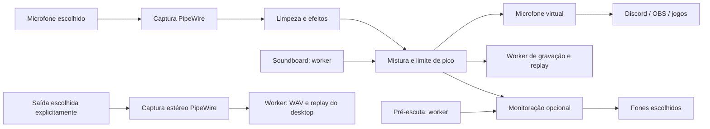

# Arquitetura

## Camadas

`voice-core` contém contratos serializáveis, controles atômicos, métricas e filas SPSC limitadas.
`voice-dsp` contém o processamento preparado; `voice-pipewire` adapta o grafo Linux;
`voice-library` concentra SQLite, decodificação, intercâmbio, cortes, mixer e replay offline.
`voice-engine` integra sessão, comandos, workers e socket. GUI, CLI e MCP usam esse registro único.
`cargo xtask boundaries` verifica a direção das dependências.

O engine escolhe o adaptador em compilação: `voice-pipewire` no Linux e `voice-wasapi`
no Windows. Os contratos de PCM, efeitos, biblioteca e comandos permanecem compartilhados.
O adaptador WASAPI prepara captura física, reprodução local e loopback explícito; não cria
um microfone virtual. Status expõe backend e capacidades, e a GUI só orienta selecionar
o dispositivo virtual quando ele existe. Consulte `WINDOWS.md` para os limites dessa etapa.

## Percurso

O callback de saída virtual consome o microfone de uma fila limitada, processa e mistura os sons.
Ele produz filas distintas para gravação e fones. Pré-escuta nunca entra no microfone virtual
ou na gravação da voz processada. A captura do desktop registra todos os sons da saída selecionada. As rotas usam nomes explícitos e excluem nós `voice-app.*` da seleção de entrada.
Na seleção automática, a metadata `default.audio.source`/`default.audio.sink` indica os dispositivos
preferidos; sem um padrão elegível, usa-se um dispositivo disponível. Mudanças dos padrões são
verificadas a cada dois segundos, sem alterar configurações do sistema. Seletores fixos são salvos
como nomes canônicos; IDs temporários não são reutilizados após uma reconexão.

Cada fila tem exatamente um produtor e um consumidor. Os callbacks usam buffers preparados,
atômicos e filas limitadas; não leem arquivos, acessam SQLite, esperam pela interface ou registram
logs. O worker de biblioteca pode alocar, decodificar, carregar clipes, misturar e gravar.
O mixer aceita até 16 vozes por rota e mantém cerca de 20 ms de áudio preparados.
Tamanho de fila não equivale a medição ponta a ponta.

O núcleo inicial trabalha em mono 48 kHz. A monitoração duplica o sinal em canais FL/FR para os
fones; não preserva estéreo de arquivos. Arquivos são convertidos offline; PipeWire negocia a
conversão dos dispositivos.

## Captura do desktop e memória

`voice-app.desktop-capture` usa Input F32LE estéreo/48 kHz, `target.object` explícito e
`stream.capture.sink=true` ([propriedades PipeWire](https://docs.pipewire.org/group__pw__keys.html)).
É independente dos três streams de voz e nunca produz amostras para o microfone virtual ou fones.
Seu callback possui scratch de 64 KiB e fila com capacidade lógica de 48.000 amostras (500 ms
estéreo), armazenamento arredondado para 256 KiB. Produtor e consumidor operam frames completos.
NaN/infinito tornam-se silêncio. Overflow descarta excedentes e incrementa o diagnóstico.

O worker é o único consumidor das filas de gravação e escreve WAV incrementalmente em disco.
Replays fixos de voz mono e desktop estéreo consomem 17,28 MB de amostras no total; salvar o maior
snapshot acrescenta no máximo 11,52 MB temporários. A duração de um arquivo não aumenta o histórico.
Cada drenagem é limitada às amostras presentes ao entrar, permitindo atender comandos mesmo com
produtor contínuo. Disco lento pode exceder a fila e perder áudio; não há fila ilimitada.

Captura do desktop começa desligada e não retoma após perder o sink/servidor. A perda finaliza
somente seu arquivo; Stop de voz não a encerra. Shutdown encerra ambos. Um heartbeat no controle
verifica o servidor mesmo se o sink estiver ocioso. A gravação de desktop inclui chamadas e a
monitoração/pré-escuta presentes na saída escolhida; não há exclusão por aplicativo nesta etapa.

## Sessão, falhas e compatibilidade

Uma biblioteca nova inicia sem captura. Após um comando Start, a intenção de conexão é salva
e retomada nas próximas aberturas. Stop cancela a intenção e as tentativas automáticas; Shutdown
finaliza a sessão atual preservando a preferência de conexão. A interface cria uma sessão local quando não há outra ativa; clientes
adicionais conectam-se à existente. Um lock impede que dois motores disputem o mesmo socket.
Permissões do diretório/socket são 0700/0600. Frames JSON são limitados a 1 MiB e têm timeout.
O controle não abre portas de rede. Ativação de captura, monitoração e gravação é explícita.

No Windows, os diretórios privados usam ACL do usuário e o controle usa named pipe local
exclusivo. O servidor rejeita clientes remotos; o cliente confere a identidade do servidor.
Os timeouts de I/O têm cancelamento com preservação dos buffers até a conclusão. O caminho
de `--socket` identifica uma sessão local e é traduzido para um nome de pipe do usuário.
O diretório de dados padrão é `%LOCALAPPDATA%\\voice-app`; caminhos personalizados não devem
ficar sob diretórios compartilhados graváveis por outras contas. Essas rotas são distintas
dos callbacks de áudio. Testes de ACL/IPC em CI não substituem validação entre contas reais.

Na perda de servidor/dispositivo, a fonte para de transmitir e a gravação é finalizada. A recuperação
usa tentativas com intervalo progressivo de dois até cinco segundos. Uma rota fixa aguarda o mesmo
nome; uma rota automática acompanha os padrões do desktop. A interface mostra a rota resolvida.
Descoberta e conexão têm deadline e acontecem no controle, fora dos callbacks de áudio. NaN e
infinitos tornam-se silêncio; o limite final evita exceder o teto de pico.
Esse limite simples não é um limitador com lookahead de qualidade de masterização.

SQLite e envelopes JSON possuem versão. Dados desconhecidos/corrompidos retornam erro e não são
recriados silenciosamente. Configurações são persistidas por substituição atômica; a monitoração
não é restaurada automaticamente. Gravações são finalizadas ao parar/encerrar o áudio.

A cadeia tem 13 blocos preparados, presentes uma vez cada: denoise, pitch/formante, gate,
ganho, filtros, compressor, saturação, robô, vocoder, granular, chorus, eco e reverb.
`DspSettings.effect_order` define uma permutação desses blocos. Vocoder e granular começam
desligados, após robô e vocoder respectivamente; arrays antigos de 11 ou 12 posições são
migrados preservando ordem e intensidades anteriores. Os índices anteriores permanecem iguais.
Configurações antigas sem esses campos recebem o padrão. Gate e compressor medem a entrada
local do próprio bloco; essa correção antecede o granular e permanece igual nesta entrega.

A ordem é publicada em um único AtomicU64, sem uma permutação parcialmente escrita no callback.
Cada processador percorre armazenamento fixo e mantém os históricos dos efeitos. Uma mudança
durante o áudio reduz o volume em 5 ms, troca a ordem no silêncio e retorna em 5 ms. A primeira
chamada usa a ordem solicitada diretamente; a transição não adiciona buffering permanente.
O teto de segurança permanece sempre ao final. Ordens inválidas são rejeitadas antes da
persistência; chamadas diretas inválidas ao DSP produzem silêncio. Novos módulos deverão
preservar o isolamento do DSP e declarar seu atraso algorítmico.
O vocoder usa 20 pares de filtros preparados, portadora interna e passagem de consoantes,
sem FIFO/FFT ou lookahead de fluxo. Filtros e envelopes ainda têm resposta temporal;
zero frames de buffering anunciado não significa latência física zero. Seu estado é fixo
e o bypass não executa o banco de filtros. Não requer modelos ou dependências novas.
Granular usa quatro grãos com janelas preparadas, histórico de capacidade fixa e referência
seca independente da realimentação. Natural limita pitch e duração, alinha as formas de onda
e protege consoantes/transientes; a qualidade percebida continua experimental. O diagnóstico
inclui o atraso nominal e as duas vozes alinham-se pelo maior atraso ativo. Mudanças de modo
ou duração incluem espera pelo novo histórico, mesmo quando o atraso nominal é igual.
Detalhes e evidências estão em [GRANULAR.md](GRANULAR.md).
No Windows, o backend envia PCM a um par de endpoints virtuais já instalado e validado,
como VB-CABLE; não instala drivers nem cria dispositivos. A frente de driver próprio
continua cancelada. macOS permanece planejado e exige integração virtual específica.

## DSP avançado

Pitch/formante usam Signalsmith Stretch0.1.3 com buffers preparados. Redução de ruído usa
RNNoise via nnnoiseless0.5.1; os blocos480frames/48k e escala PCM são adaptados no motor.
Chorus usa delay modulado fracionário. Todos são opcionais; o caminho básico tem buffering
algorítmico declarado zero. Pitch/formante adicionam88ms, denoise20ms, ambos108ms a48k.
Isso não inclui PipeWire/dispositivos nem o atraso artístico intencional de eco/reverb.
A meta de80ms para pitch ainda é uma pendência, não uma garantia.

O inventário de distribuição registra o modelo RNNoise embutido, origem e fingerprint,
além das licenças de código e fontes. Conversão neural de identidade vocal não está implementada.
